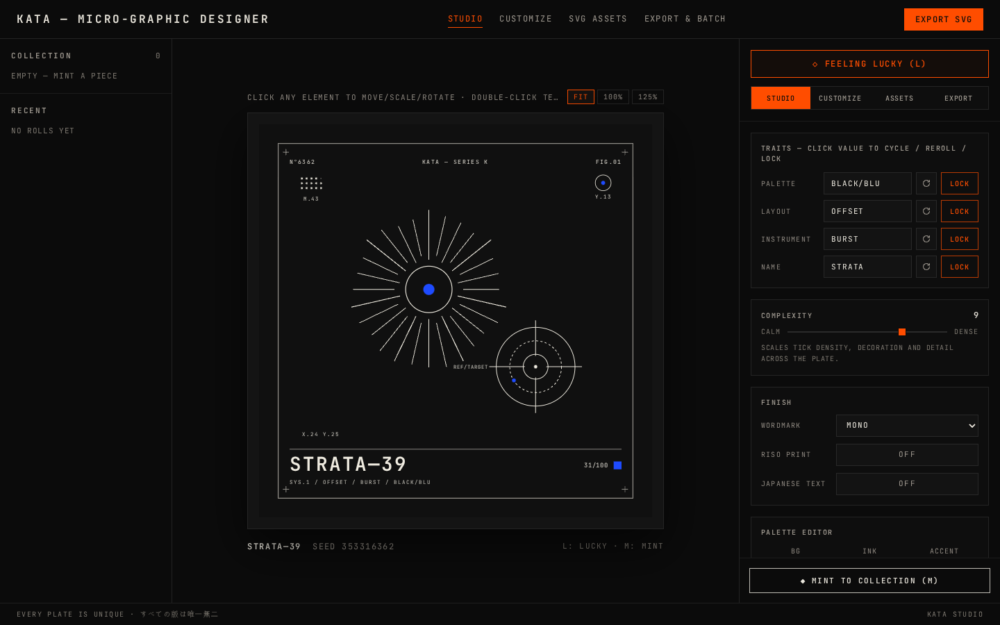
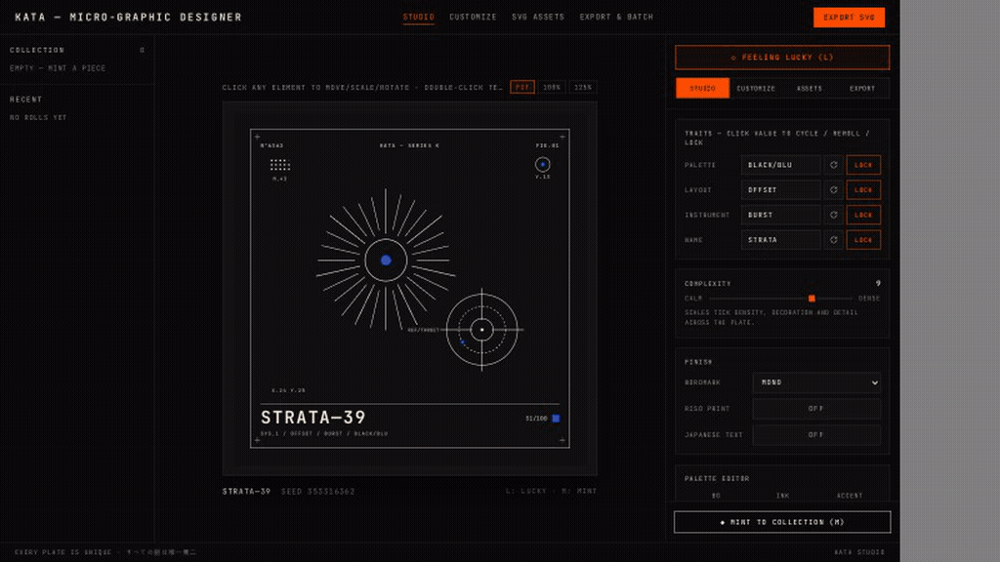
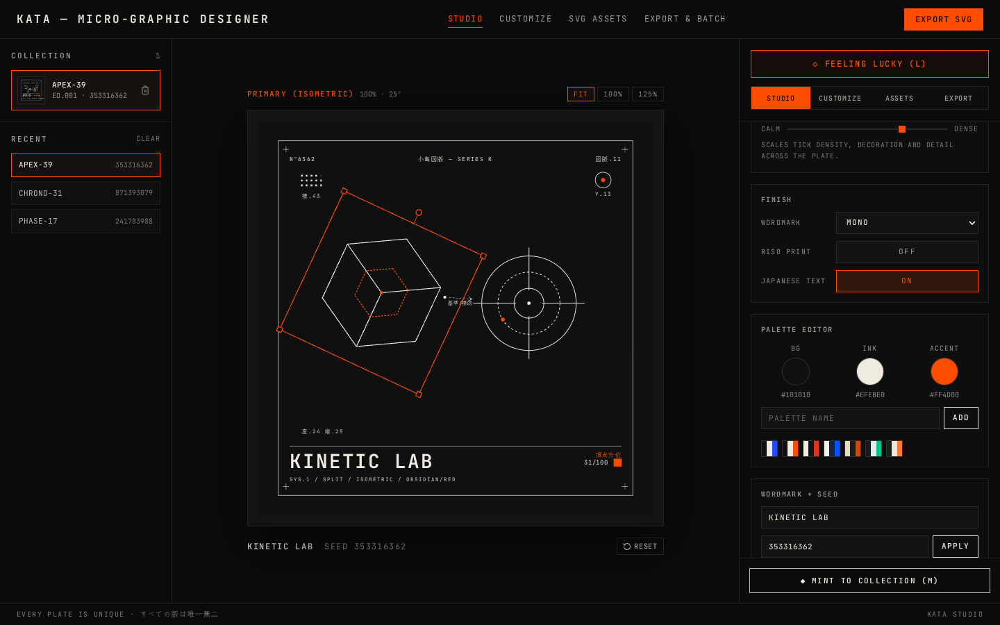
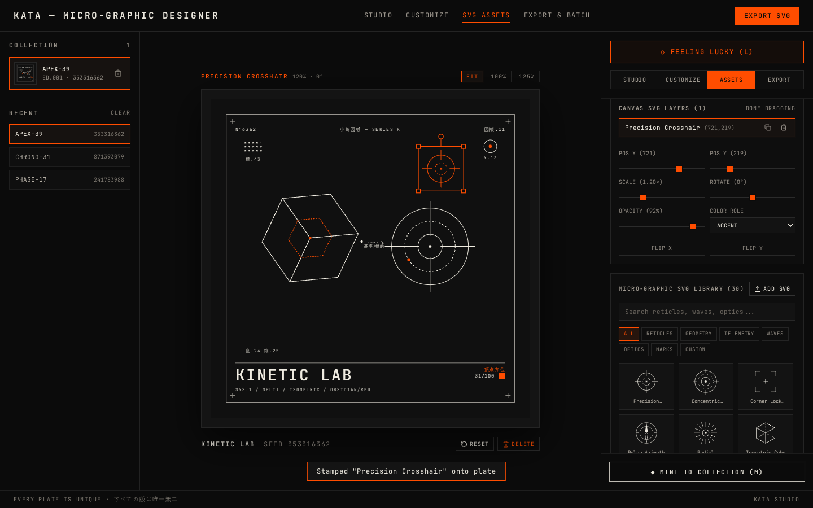
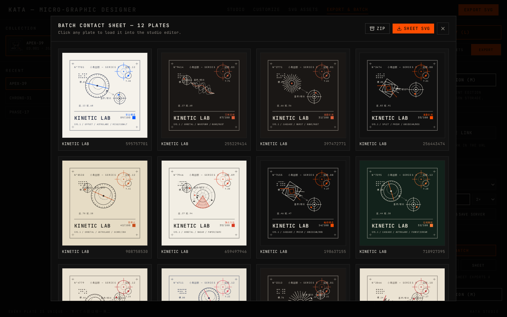

# KATA — Micro-Graphic Designer (`MICRO_SYS`)

> A deterministic, Swiss-editorial **procedural micro-graphic & risograph poster studio** built with React, TypeScript, SVG, and an Express local JSON backend. Generate, customize, transform in-view, stamp, mint, and export print-ready vector plates.

<p align="center">
  
</p>

---

## Live Walkthrough

A quick tour through deterministic plate generation, **in-view bounding-box transforms**, **double-click inline text editing**, the **30-piece SVG Asset library**, minting to the **server-side collection**, and the **12-plate Batch Contact Sheet**:

<p align="center">
  
</p>

> Full-resolution recording: [`docs/media/kata-walkthrough.webm`](docs/media/kata-walkthrough.webm)

---

## Showcase

### 1. In-View Bounding-Box Transforms & Inline Text Editing
Click any graphic layer, stamp, or typographic block directly on the artboard to reveal an interactive **bounding box** (drag to move, corner handles to scale, top rotation handle with `Shift` `15°` snapping, and arrow-key micro-nudging). **Double-click any of the 11 text elements**—headline wordmark, Japanese subtitle, telemetry coordinates, spec labels, barcode label, or footer notes—to edit copy live on the plate.

<p align="center">
  
</p>

### 2. Micro-Graphic SVG Asset Library & Custom SVG Importer
Browse **30 curated vector micro-graphics** across six technical categories (`RETICLES`, `GEOMETRY`, `TELEMETRY`, `WAVES`, `OPTICS`, `MARKS`), or upload your own `.svg` files. Every uploaded asset is sanitized on the server and persisted to local JSON storage so your custom stamps stay available across restarts.

<p align="center">
  
</p>

### 3. Batch Contact Sheets & Multi-Format Export
Roll a **Batch Contact Sheet (12 Plates)** seeded from your current parameters, click any thumbnail to load it straight into the studio, download the entire contact sheet as a single vector SVG, or export a **ZIP archive** containing all 12 plates.

<p align="center">
  
</p>

---

## Features

- **Deterministic Seeded Engine** — Every composition is reproducible from a single numeric seed and URL hash (`#s=...&lp=...`), making designs effortless to share or revisit.
- **14 Curated Duotone/Tri-Color Palettes + Custom Palette Studio** — Includes *BLACK/BLU*, *OBSIDIAN/RED*, *PAPER/SUMI*, *RISO/COBALT*, *OCHRE/INK*, *SIGNAL/SLATE*, *FOREST/CREAM*, *KLEIN/CHALK*, *CORAL/GRAPHITE*, *MINT/CARBON*, *SEPIA/CRIMSON*, *AMBER/VOID*, *SAND/NAVY*, and *BONE/RUST*, plus live BG / INK / ACCENT pickers saved to the server.
- **12 Procedural Geometric Instruments** — *BURST*, *RETICLE*, *WAVEFORM*, *MATRIX*, *ORBIT*, *VERNIER*, *CONTOUR*, *PRISM*, *RADAR*, *SPECTRUM*, *ISOMETRIC*, and *ASTROLABE* paired with **8 grid layouts** (*OFFSET*, *CENTERED*, *SPLIT*, *QUADRANT*, *DIAGONAL*, *ORBITAL*, *MODULAR*, *CASCADE*) and adjustable **Complexity (1–12)**.
- **Direct Canvas Manipulation** — Independent interactive bounding boxes for primary/secondary instruments, typography blocks, barcode/QR/color-chip modules, and stamped SVG layers, with `Move`, `Scale`, `Rotate`, per-element lock/reset, and **Reset All Transforms**.
- **Full Inline Typography Control** — Switch between *MONO*, *CONDENSED*, and *GROTESK* wordmarks, toggle *Japanese Text* (`地層標本`, etc.), *Barcode*, *Color Chip*, *Corner Marks*, *Grid Mesh*, and *Riso Print* (subtle ink misregistration + procedural `feTurbulence` paper grain).
- **4 Output Formats** — `SQUARE 1:1`, `POSTER 2:3`, `WIDE 2:1`, and `AVATAR` crops.
- **Multi-Format Export Pipeline**:
  - Vector **SVG** download
  - High-DPI **PNG** (`1×`, `2×`, `4×`)
  - **Save SVG to Disk** directly into `./data/exports/` via the Express backend
  - **12-Plate Batch Contact Sheet** (`SVG` sheet + `.zip` bundle via JSZip)
  - Copyable **Share URL** hash
- **Server-Side Local JSON Storage** — No browser `localStorage` dependency for your work; minted Editions, custom palettes, uploaded SVG assets, recent roll history, and saved `.svg` exports persist on disk under `./data/`.

---

## Keyboard Shortcuts

| Shortcut | Action |
| --- | --- |
| `L` | Roll **Feeling Lucky** (respects locked Palette / Layout / Instrument / Complexity traits) |
| `M` | **Mint** current plate to the server-side Collection |
| `Arrow Keys` | Nudge the selected canvas element by `±3px` |
| `Shift` + `Arrow Keys` | Nudge the selected canvas element by `±12px` |
| `Shift` + Rotate Handle | Snap rotation to `15°` increments |
| `Double-Click` (on text) | Enter inline text editing (`Enter` to commit, `Esc` to cancel) |
| `Delete` / `Backspace` | Remove the currently selected SVG stamp |
| `Escape` | Deselect active element / exit inline edit |

---

## Installation & Running Locally

### Prerequisites
- **Node.js** `v20+` (`v22.6+` recommended for native TypeScript execution on `npm start`)
- **npm** `v9+`

### 1. Install dependencies
```bash
npm install
```

### 2. Start the development server
Runs the Express API backend and Vite middleware together on port `3000`:
```bash
npm run dev
```
Open **[http://localhost:3000](http://localhost:3000)** in your browser.

### 3. Build and run in production
```bash
npm run build
NODE_ENV=production npm start
```
> **Note:** On Node.js `< 22.6`, run the production server with `NODE_ENV=production npx tsx server.ts`.

### Environment Variables (Optional)

| Variable | Default | Description |
| --- | --- | --- |
| `PORT` | `3000` | HTTP port for the Express server and UI |
| `DISABLE_HMR` | `false` | Set to `true` to disable Vite HMR file watching |

---

## Testing & Verification

Run the unit test suite (`node:test` via `tsx`) and TypeScript type checker:

```bash
# Procedural engine & JSON store unit tests
npx tsx --test src/engine/generator.test.ts src/server/db.test.ts

# TypeScript static type check
npm run lint
```

---

## Architecture & Project Structure

```text
├── server.ts                  # Express server, REST API routes, Vite/static serving
├── data/                      # Local JSON persistence & disk exports (auto-created)
│   ├── collection.json        # Minted editions
│   ├── palettes.json          # Saved custom palettes
│   ├── assets.json            # Uploaded & sanitized custom SVG stamps
│   ├── recent.json            # Recent roll history
│   └── exports/               # Server-saved .svg plates
├── docs/media/                # Showcase screenshots, GIF & WebM walkthrough
└── src/
    ├── App.tsx                # Application state, URL hash sync, keyboard shortcuts
    ├── engine/
    │   ├── generator.ts       # Deterministic PRNG, procedural instruments, SVG builder
    │   ├── palettes.ts        # 14 built-in palettes, layouts, piece titles & kanji
    │   ├── svgAssets.ts       # 30 built-in SVG micro-graphic stamps
    │   └── types.ts           # Shared state, transform & configuration types
    ├── components/
    │   ├── HeaderBar.tsx      # Top bar: Feeling Lucky, Batch 12x, Mint Edition, Export
    │   ├── StudioTab.tsx      # Core parameters, trait locks, quick stamps, layer controls
    │   ├── SvgAssetsTab.tsx   # Categorized SVG asset library & custom .svg uploader
    │   ├── CustomizeTab.tsx   # Wordmark, font, Japanese label, Risograph & grid toggles
    │   ├── ExportTab.tsx      # SVG, 1x/2x/4x PNG, disk save & URL sharing
    │   ├── PlateViewport.tsx  # Interactive SVG artboard, bounding-box gizmo & inline editor
    │   ├── InspectorPanel.tsx # Live spec telemetry & active selection transform controls
    │   ├── CollectionSidebar.tsx # Minted editions & recent roll history
    │   └── BatchModal.tsx     # 12-plate contact sheet preview & ZIP exporter
    ├── server/
    │   └── db.ts              # Atomic local JSON store & SVG sanitizer
    └── utils/
        ├── api.ts             # Typed client wrappers for /api/* endpoints
        └── exportUtils.ts     # PNG rasterization, SVG download & ZIP packaging
```

### Server REST API

| Method | Endpoint | Description |
| --- | --- | --- |
| `GET` | `/api/health` | Server & local JSON storage status |
| `GET` / `POST` / `DELETE` | `/api/collection` (`/:id`) | List, mint, or delete saved editions |
| `GET` / `POST` / `DELETE` | `/api/palettes` (`/:id`) | List, create, or delete custom palettes |
| `GET` / `POST` / `DELETE` | `/api/recent` | Read, push, or clear recent roll history |
| `GET` / `POST` / `DELETE` | `/api/assets` (`/:id`) | List, upload/sanitize, or delete custom SVG assets |
| `GET` / `POST` | `/api/exports` | List or save `.svg` files directly to `./data/exports/` |

---

## Tech Stack

- **Frontend:** React 19, TypeScript, Vite 8, Tailwind CSS v4, Lucide Icons, Motion, JSZip
- **Backend & Persistence:** Express 4, Node.js `fs/promises` local JSON store
- **Vector Engine:** Pure deterministic SVG generation with procedural Risograph paper grain & misregistration filters
